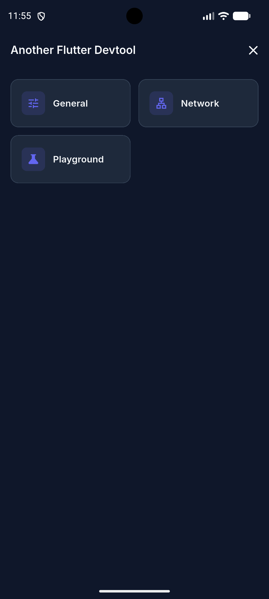
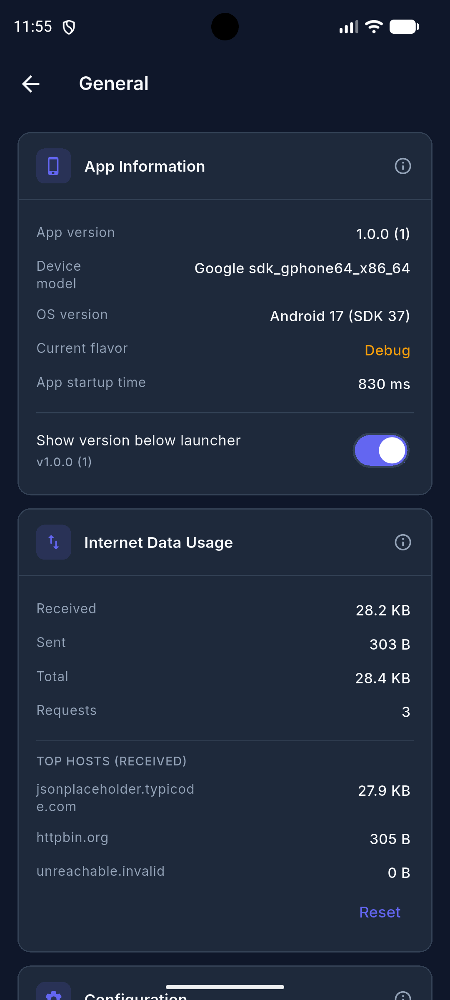
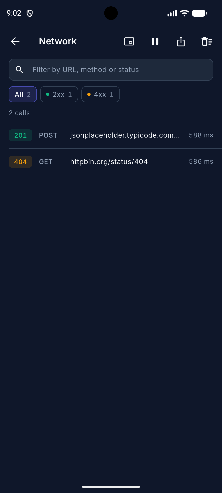
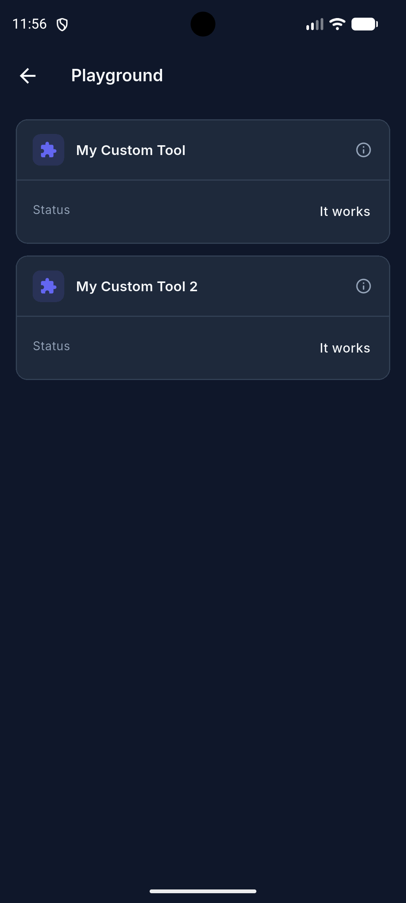
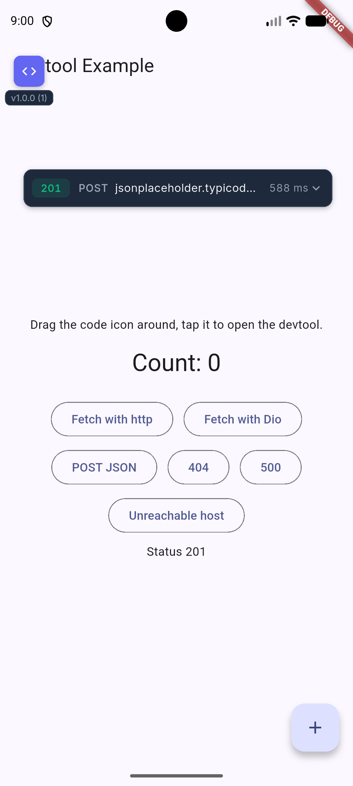
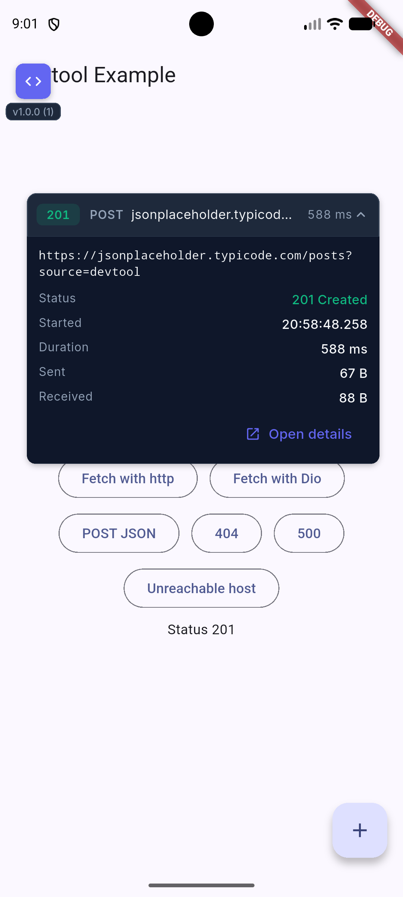

# another_flutter_devtool

[](https://pub.dev/packages/another_flutter_devtool)
[](https://github.com/B3K4682/another_flutter_devtool/actions/workflows/release.yml)

An in-app devtool for Flutter. Wrap your app, and a small draggable launcher button appears on top of it. Tap it to open a full-screen devtool panel without leaving the app.

> **Beta:** usable today, but the API may change before 1.0. More built-in tools are coming.

| Home | General | Network | Custom tools |
| :---: | :---: | :---: | :---: |
|  |  |  |  |

## Live API call overlay

Watch your API traffic without opening the devtool. Turn it on from the Network header, and a floating card shows
the latest call's status, method, URL and duration as requests happen.

| Floating card | Tapped open |
| :---: | :---: |
|  |  |

Drag it anywhere, tap it for the full URL, timing and sizes, or open the call's full details. The on/off choice is
remembered across restarts.

## Features

- Draggable launcher button with an optional app version badge, opening a full-screen panel.
- App Information: version, build, device, OS, flavor and startup time.
- Internet Data Usage: data sent and received, request count and top hosts since launch.
- Network: every HTTP call with request, response and error; search, status filters, JSON export and Copy as cURL.
  Sensitive headers and tokens are masked by default. Works with Dio and `http` with no setup.
- Configuration: type a route to jump straight to that screen. Works with any router.
- Extensible with your own sections and tools.
- Isolated from your app (own `MaterialApp` and theme), off by default, with stable widget keys for testing.

## Getting started

```yaml
dependencies:
  another_flutter_devtool: ^0.5.5
```

## Usage

Wrap the widget you pass to `runApp`:

```dart
import 'package:another_flutter_devtool/another_flutter_devtool.dart';
import 'package:flutter/foundation.dart';
import 'package:flutter/material.dart';

void main() {
  // For tracking startup time. (optional)
  AnotherFlutterDevtool.markStartup();

  runApp(
    AnotherFlutterDevtool(
      config: const DevtoolConfig(enabled: kDebugMode),
      child: const MyApp(),
    ),
  );
}
```

That already gives you the General section with the App Information, Internet Data Usage and Configuration cards in it.

### Navigation

The Configuration card has a route input. Since the devtool panel runs in its own
`MaterialApp`, tell it how to reach your app's router with `onNavigate`; the devtool
closes and then calls it with the typed route:

```dart
final navigatorKey = GlobalKey<NavigatorState>();

AnotherFlutterDevtool(
  config: DevtoolConfig(
    enabled: kDebugMode,
    sections: [
      GeneralSection(
        configuration: ConfigurationTool(
          onNavigate: (route) => navigatorKey.currentState?.pushNamed(route),
        ),
      ),
    ],
  ),
  child: MaterialApp(navigatorKey: navigatorKey, routes: {...}),
);
```

With go_router, use `onNavigate: (route) => router.go(route)` instead. Without
`onNavigate`, the input stays disabled.

### Network

Add `NetworkSection` to see every HTTP call made through dart:io's `HttpClient`
(Dio, `http`, `Image.network`). It is not available on web.

```dart
const DevtoolConfig(
  enabled: kDebugMode,
  sections: [GeneralSection(), NetworkSection()],
);
```

- Search by URL, method or status (`post 404` matches both), or use the 2xx / 3xx / 4xx / 5xx / Failed chips.
- Tap a call for its query parameters, headers, bodies and error with stack trace.
- **Sensitive values are masked** as `[redacted]` on screen and in exports, so screenshots are safe to share:
  `Authorization`, cookies, API-key headers and token query parameters like `access_token`. The eye button on a
  call reveals them; Copy as cURL is never masked. Bodies are not masked. Customise with
  `NetworkSection(redactedHeaders: {...defaultRedactedHeaders, 'x-my-secret'}, redactedQueryParameters: {...})`.
- Keeps the last 500 calls and caps bodies at 256 KB; change with `NetworkSection(recorder: NetworkRecorder(maxCalls: 1000))`.

### Configuration

```dart
const DevtoolConfig(
  enabled: true, // false renders only your app
  launcher: LauncherConfig(
    enabled: true, // false never shows the launcher
    initiallyVisible: true, // whether the launcher is visible on start
  ),
  sections: [GeneralSection()], // cards on the devtool home screen
);
```

### Sections and tools

`sections` holds the cards shown on the home screen; it never holds tools. A tool
declares the section it belongs to and shows up there on its own. `GeneralSection`
ships with `AppInfoTool`, `NetworkUsageTool` and `ConfigurationTool`, so you get app
version, device, OS, flavor, startup time and network usage without any wiring.

To add your own, create a section, point a tool at it, and register the tool once:

```dart
const playgroundSection = DevtoolSection(
  id: 'playground',
  title: 'Playground',
  icon: Icons.science_rounded,
);

class MyCustomTool extends DevtoolTool {
  const MyCustomTool();

  @override
  String get id => 'my_custom_tool';

  @override
  String get title => 'My Custom Tool';

  @override
  IconData get icon => Icons.extension_rounded;

  @override
  String get description => 'Shown in the card\'s info modal.';

  @override
  DevtoolSection get section => playgroundSection; // belongs to

  @override
  Widget build(BuildContext context, DevtoolController controller) => DevtoolCard(
        icon: icon,
        title: title,
        description: description,
        child: const DevtoolInfoRow(label: 'Status', value: 'It works'),
      );
}

void main() {
  DevtoolTools.register(const MyCustomTool());

  runApp(
    AnotherFlutterDevtool(
      config: const DevtoolConfig(
        enabled: kDebugMode,
        sections: [GeneralSection(), playgroundSection],
      ),
      child: const MyApp(),
    ),
  );
}
```

Registering a tool whose id matches a built-in replaces it, so
`DevtoolTools.register(const AppInfoTool(flavor: 'Staging'))` customises the
built-in card. `GeneralSection(appInfo: null)` hides it instead, and the same works
for `networkUsage` and `configuration`.

### Testing

Use `DevtoolKeys` to find devtool widgets in widget or integration tests:

```dart
await tester.tap(find.byKey(DevtoolKeys.launcher));
await tester.pumpAndSettle();
expect(find.byKey(DevtoolKeys.panel), findsOneWidget);

await tester.tap(find.byKey(DevtoolKeys.closeButton));
```

## Example

See the [example](https://github.com/B3K4682/another_flutter_devtool/tree/main/example) folder for a runnable app and integration tests.

## Contributing

Issues and pull requests are welcome on [GitHub](https://github.com/B3K4682/another_flutter_devtool).